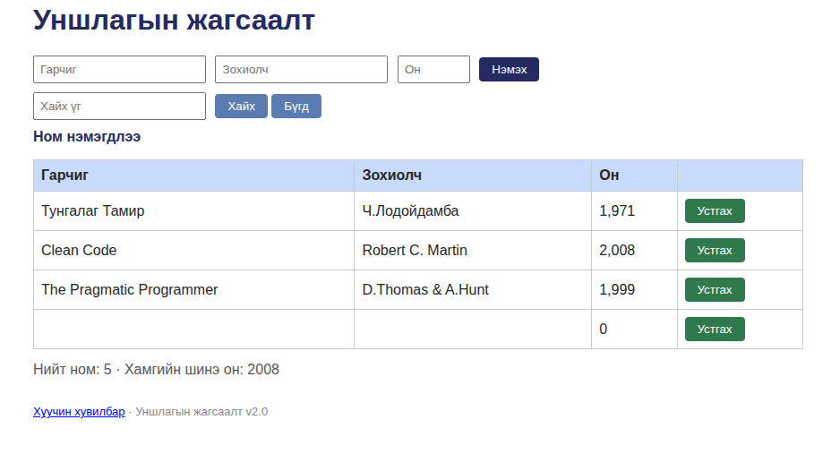

# BUG-01: Ном нэмэх талбарууд хоосон байхад валидац хийхгүй, хоосон ном нэмэгдэнэ

Орчин: Уншлагын жагсаалт v2.0, Chromium 152.0.7977.64, Ubuntu Linux, 2026-10-20
Урьдчилсан нөхцөл: node app.js-ийг шинээр асаасан (анхны 3 ном)

## Дахин гаргах алхам
1. http://localhost:3000 нээх
2. Гарчиг, Зохиолч, Он гурван талбарыг бүгдийг нь хоосон орхих
3. "Нэмэх" товч дарах

Хүлээгдэж байсан: Спек дүрэм #1-ээр (3 талбар бүгд заавал бөглөгдсөн байх; дутуу бол ном нэмэгдэхгүй, алдааны мессеж гарна) — ном нэмэгдэхгүй, ойлгомжтой алдааны мессеж гарах ёстой.
Бодит үр дүн: Хоосон ном хүснэгтэд нэмэгдэв (Гарчиг/Зохиолч хоосон, Он баганад "0"). "Ном нэмэгдлээ" гэсэн амжилтын мессеж гарч, Нийт ном тоолуур нэмэгдэв. Ямар ч валидац байхгүй.
Ноцтой байдал: Major — валидац огт байхгүй тул систем хог, утгагүй бичлэгээр дүүрэх боломжтой; өгөгдлийн бүрэн бүтэн байдлыг алдагдуулна.
Хавсралт: 
Олдсон аялал: Couch Potato (хоосон оролт)
