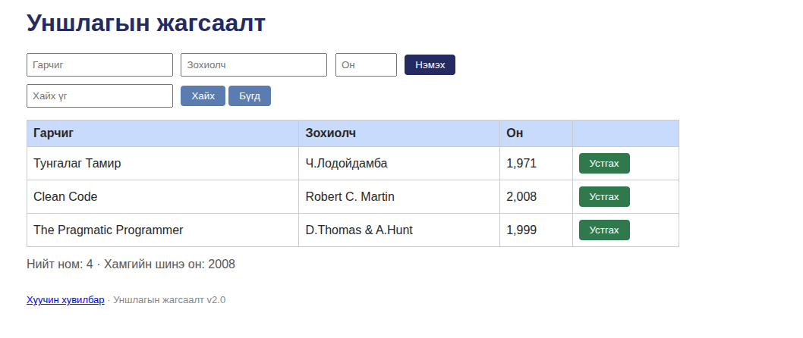

# BUG-02: "Нийт ном" тоолуур жинхэнэ номын тооноос нэгээр илүү харуулна

Орчин: Уншлагын жагсаалт v2.0, Chromium 152.0.7977.64, Ubuntu Linux, 2026-10-20
Урьдчилсан нөхцөл: node app.js-ийг шинээр асаасан (анхны 3 ном)

## Дахин гаргах алхам
1. http://localhost:3000 нээх
2. Хүснэгт дэх номын мөрийг тоолох (3 ном байна)
3. Доорх "Нийт ном: X" тоог харах

Хүлээгдэж байсан: Спек дүрэм #7-оор (Нийт ном тоолуур хүснэгтэд буй номын тоотой тэнцүү) — тоолуур 3 гэж харуулах ёстой.
Бодит үр дүн: Тоолуур "Нийт ном: 4" гэж харуулж байна (3 ном байхад). Тоолуур үргэлж жинхэнэ тооноос 1-ээр илүү.
Ноцтой байдал: Minor — буруу мэдээлэл харуулж байгаа ч өгөгдөл алдагдахгүй, үндсэн үйлдэлд саад болохгүй.
Хавсралт: 
Олдсон аялал: Fed-Ex (өгөгдлийн зам)
