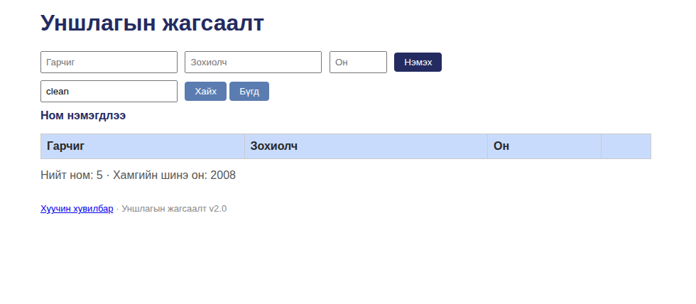

# BUG-04: Хайлт том/жижиг үсэг ялгадаг тул жижиг үсгээр хайхад ном олдохгүй

Орчин: Уншлагын жагсаалт v2.0, Chromium 152.0.7977.64, Ubuntu Linux, 2026-10-20
Урьдчилсан нөхцөл: node app.js-ийг шинээр асаасан (анхны 3 ном)

## Дахин гаргах алхам
1. http://localhost:3000 нээх
2. "Хайх үг" талбарт жижиг үсгээр "clean" гэж бичих
3. "Хайх" товч дарах

Хүлээгдэж байсан: Спек дүрэм #4-ээр (Хайлт том/жижиг үсэг ЯЛГАХГҮЙ) — "Clean Code" ном олдож харагдах ёстой.
Бодит үр дүн: Хүснэгт хоосон буцаж, "Clean Code" олдсонгүй. Зөвхөн яг том/жижиг үсэг тохирсон үед л олдоно.
Ноцтой байдал: Major — хайлт бол гол үйлдэл; хэрэглэгч ихэвчлэн жижиг үсгээр хайдаг тул бодит ашиглалтад хайлт ажиллахгүйтэй адил.
Хавсралт: 
Олдсон аялал: Couch Potato / GUI хайлт
