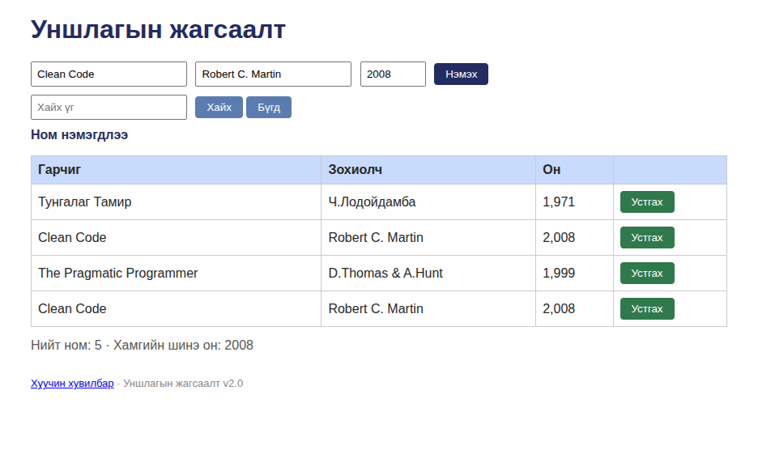

# BUG-05: Ижил гарчиг, зохиолчтой номыг давхардуулж нэмж болно

Орчин: Уншлагын жагсаалт v2.0, Chromium 152.0.7977.64, Ubuntu Linux, 2026-10-20
Урьдчилсан нөхцөл: node app.js-ийг шинээр асаасан (анхны 3 ном, "Clean Code" багтсан)

## Дахин гаргах алхам
1. http://localhost:3000 нээх
2. Гарчиг: Clean Code, Зохиолч: Robert C. Martin, Он: 2008 гэж бичих
3. "Нэмэх" товч дарах
4. Хүснэгтийг харах

Хүлээгдэж байсан: Спек дүрэм #3-аар (Ижил гарчиг, зохиолчтой ном давхардуулж нэмэгдэхгүй) — давхар бичлэг нэмэгдэхгүй, анхааруулга гарах ёстой.
Бодит үр дүн: "Clean Code / Robert C. Martin / 2008" хоёр дахь удаа нэмэгдэж, хүснэгтэд хоёр ижил бичлэг үүсэв. Давхардлын шалгалт байхгүй.
Ноцтой байдал: Major — давхардсан өгөгдөл хуримтлагдаж, жагсаалтын найдвартай байдлыг алдагдуулна.
Хавсралт: 
Олдсон аялал: Fed-Ex (өгөгдлийн зам)
