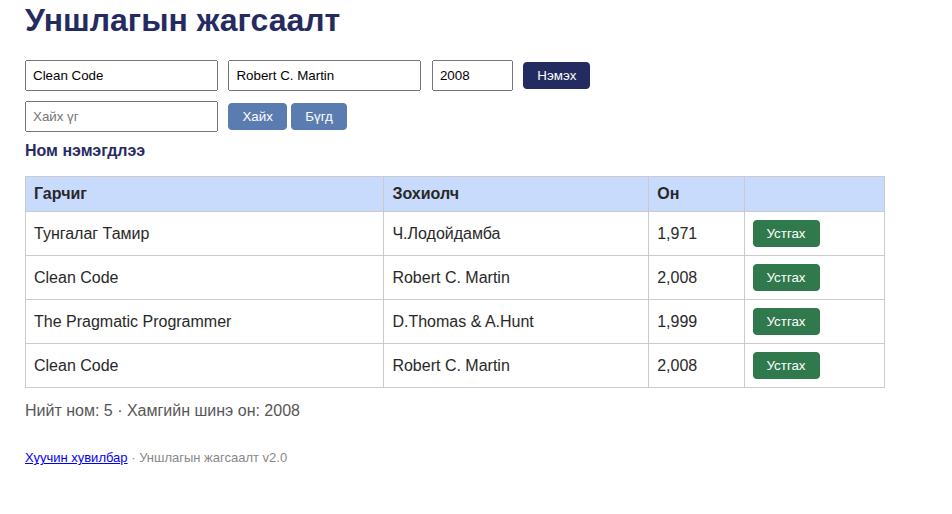

# BUG-06: Он баганын тоо энгийн тооны оронд мянгатын таслалтай харагдана

Орчин: Уншлагын жагсаалт v2.0, Chromium 152.0.7977.64, Ubuntu Linux, 2026-10-20
Урьдчилсан нөхцөл: node app.js-ийг шинээр асаасан (анхны 3 ном)

## Дахин гаргах алхам
1. http://localhost:3000 нээх
2. Хүснэгтийн "Он" баганыг харах

Хүлээгдэж байсан: Спек дүрэм #2-оор (Он нь хүснэгтэд энгийн тоогоор, жишээ нь 1999 харагдана) — "1971", "2008", "1999" гэж таслалгүй харагдах ёстой.
Бодит үр дүн: Он "1,971", "2,008", "1,999" гэж мянгатын таслалтай харагдаж байна.
Ноцтой байдал: Cosmetic — зөвхөн харагдах байдлын асуудал, өгөгдөл зөв хадгалагдсан.
Хавсралт: 
Олдсон аялал: Supermodel (GUI харагдах байдал)
