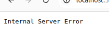

# BUG-07: "Хуучин хувилбар" линк 500 Internal Server Error буцаана

Орчин: Уншлагын жагсаалт v2.0, Chromium 152.0.7977.64, Ubuntu Linux, 2026-10-20
Урьдчилсан нөхцөл: node app.js-ийг шинээр асаасан

## Дахин гаргах алхам
1. http://localhost:3000 нээх
2. Хуудасны доод талын footer дахь "Хуучин хувилбар" линк дээр дарах (/old хуудас руу очно)

Хүлээгдэж байсан: Спек дүрэм #8-аар (бүх хуудас, линк ажиллана) — хуудас хэвийн нээгдэх ёстой.
Бодит үр дүн: Хуудас "Internal Server Error" (HTTP 500) алдаа буцаав.
Ноцтой байдал: Major — санал болгосон линк эвдэрсэн, серверийн алдаа руу хүргэж байна.
Хавсралт: 
Олдсон аялал: Fed-Ex / GUI навигац
