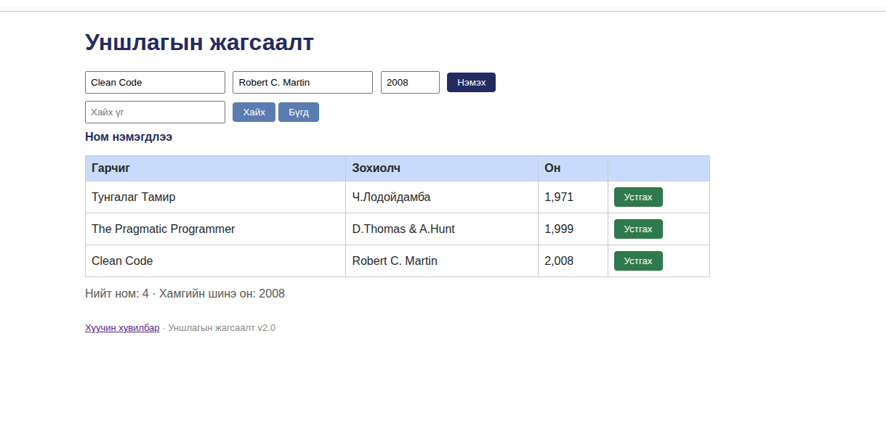

# BUG-08: Ном устгасны дараа "Ном нэмэгдлээ" гэсэн буруу мессеж гарна

Орчин: Уншлагын жагсаалт v2.0, Chromium 152.0.7977.64, Ubuntu Linux, 2026-10-20
Урьдчилсан нөхцөл: node app.js-ийг шинээр асаасан (анхны 3 ном)

## Дахин гаргах алхам
1. http://localhost:3000 нээх
2. Аль нэг номын мөрийн "Устгах" товч дарах
3. Ном устсаны дараа товчнуудын доорх мессежийг харах

Хүлээгдэж байсан: Спек дүрэм #5-аар (Үйлдэл бүрийн дараах мессеж тухайн үйлдэлдээ тохирно) — устгалын дараа "Ном устгагдлаа" гэх мэт тохирох мессеж гарах ёстой.
Бодит үр дүн: Ном устсан хэдий ч товчны доор "Ном нэмэгдлээ" гэсэн мессеж гарч байна — устгах үйлдэлд тохирохгүй.
Ноцтой байдал: Minor — хэрэглэгчийг төөрөгдүүлэх боловч өгөгдөлд нөлөөлөхгүй.
Хавсралт: 
Олдсон аялал: Supermodel (GUI мессеж)
